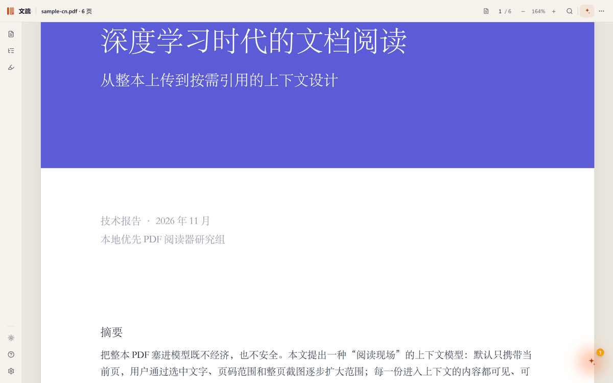
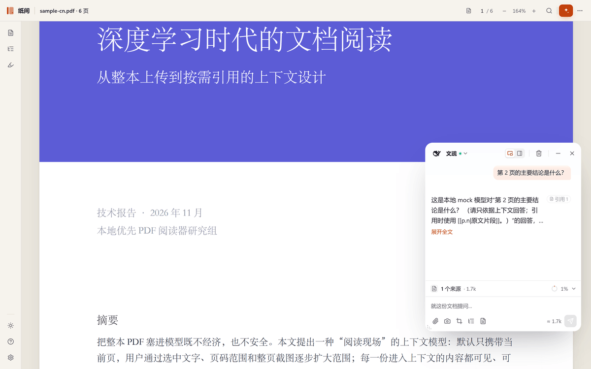
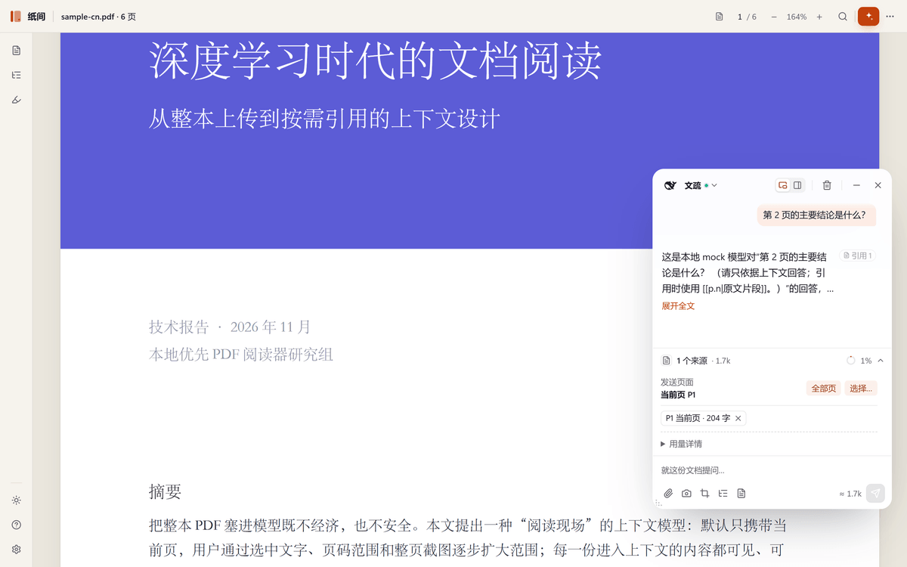
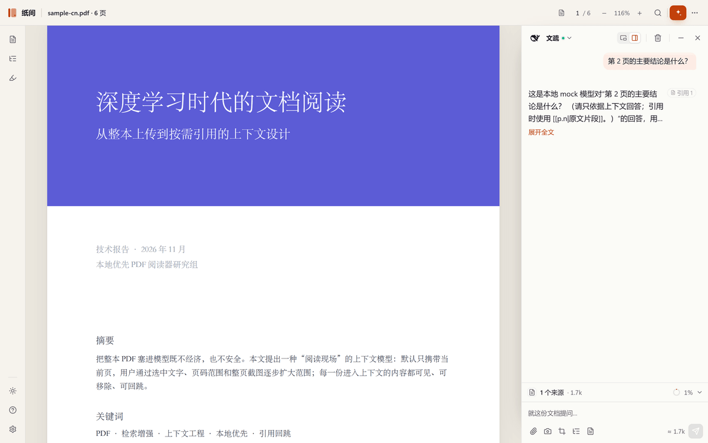
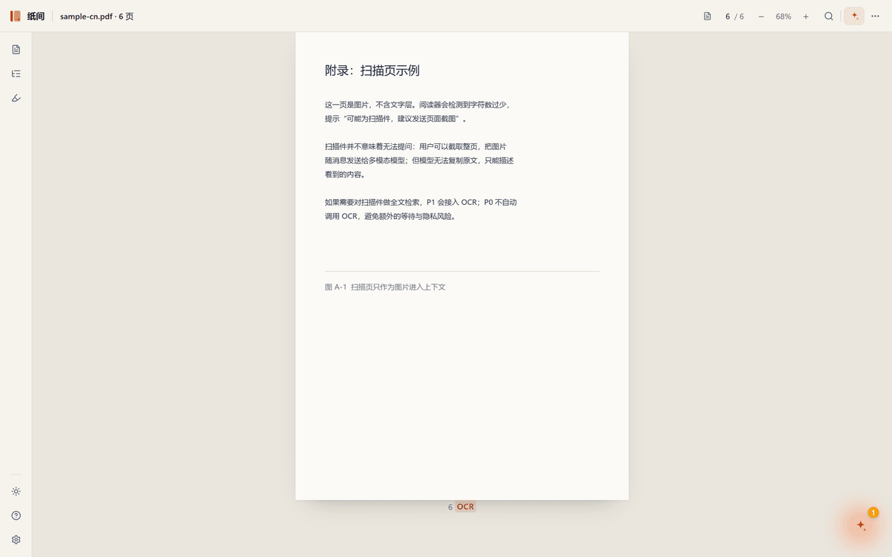

# Paper Reader · PDF × AI

A local-first PDF reader with an AI reading assistant. The PDF itself stays on your machine; only the pages, text, screenshots and attachments you explicitly select are sent to the model through a local proxy.

[中文说明](README.md) · [Architecture](docs/ARCHITECTURE.md) · [Privacy](docs/PRIVACY.md) · [Release](docs/RELEASE.md)



## Why Paper Reader

- **The PDF never leaves the browser.** pdf.js parses locally; the model only receives the context you select.
- **Citations jump to the line.** Each citation carries a short quote and returns to the exact line with a brief highlight.
- **Scanned pages work too.** Local OCR builds a line-level text layer for selection, search, highlights and questions.
- **Long documents stay cheap.** Local BM25 sends only relevant chunks; whole-document summaries run map-reduce.

## Overview

| Assistant                                    | Context                                  |
| -------------------------------------------- | ---------------------------------------- |
|  |  |

| Sidebar                                  | OCR                              |
| ---------------------------------------- | -------------------------------- |
|  |  |

## Features

- Virtualized pages, true-DPR canvas, 100% = 96dpi, fit width / fit page.
- Ctrl + wheel zooms around the pointer without moving the current reading position.
- Every shortcut can be re-recorded in the shortcuts panel with conflict checks and reset-to-default.
- Color modes: original / invert / smart dark / grayscale / eye-care with intensity.
- Password PDFs, recent documents, thumbnails, outline, internal and external links.
- Full-text search with text-layer highlights, persistent highlights and Markdown/JSON export.
- Context: current page, all pages, ranges, TOC chapters, selection, page/region screenshots, attachments and quoted messages.
- Local BM25 filtering and map-reduce summaries with progress and cancellation.
- Streaming answers, reasoning stream, line-level citations with jump-and-flash, Markdown + KaTeX, token meter and configurable pricing.
- Multiple chat sessions, history window, per-message quote/exclude.
- Local PP-OCRv6 tiny/small/medium with a line-level text layer; custom mirror root supported.
- Electron shell, local proxy, manual update check, no telemetry.
- Branded startup shell appears at ~0.5s; the reader is ready at ~1.4s locally.

## Quick start

Requires Node.js 24+.

```bash
npm install
copy server\.env.example server\.env
# edit server/.env: AI_API_KEY=sk-...  (or MOCK_AI=1)
npm run dev:all
```

Open <http://127.0.0.1:5173>.

Desktop:

```bash
npm run desktop:dev
npm run package:desktop   # portable directory in release/
npm run build:installers  # NSIS .exe + MSI in release/
```

Set `MOCK_AI=1` to stream a local mock answer without calling a real model.

## Privacy

- The main PDF is parsed locally and never uploaded as a file.
- Only selected page text, selection, screenshots, attachments and questions are sent to the configured provider.
- Keys live in the local proxy (`server/data/provider.json` or Electron `userData`), not in the frontend bundle.
- Chats, reading position, highlights, OCR text and recent documents live in local IndexedDB.
- Recent document cache: ≤24MB per file, ≤64MB total, 8 entries.
- OCR inference runs in a local worker; images are not sent to a cloud OCR service.
- The desktop app ships without OCR: the runtime pack (~26MB compressed) and models are
  downloaded only when you enable OCR in Settings. Downloads follow the Windows system proxy
  and always bypass it for localhost.
- Update checks run only when you click the button, and only against GitHub Releases.
- Settings → About can register PaperReader as a PDF opener. It never changes the default
  silently; Windows Settings asks you to confirm.

See [docs/PRIVACY.md](docs/PRIVACY.md) for details.

## Development

```bash
npm run typecheck
npm run lint
npm run format:check
npm test              # 81 unit tests
npm run test:coverage # v8 coverage with src/lib thresholds
npm run test:e2e      # 41 Playwright tests (PW_CHANNEL=chromium on Linux)
npm run build
npm run build:server
```

## Docs

[Documentation index](docs/README.md) · [Desktop](docs/DESKTOP.md) · [Brand](docs/BRAND.md) · [OCR mirror](docs/OCR-MIRROR.md) · [Roadmap](docs/ROADMAP.md)

## License

MIT. See [LICENSE](LICENSE), [CONTRIBUTING.md](CONTRIBUTING.md), [SECURITY.md](SECURITY.md) and [THIRD_PARTY_NOTICES.md](THIRD_PARTY_NOTICES.md).
