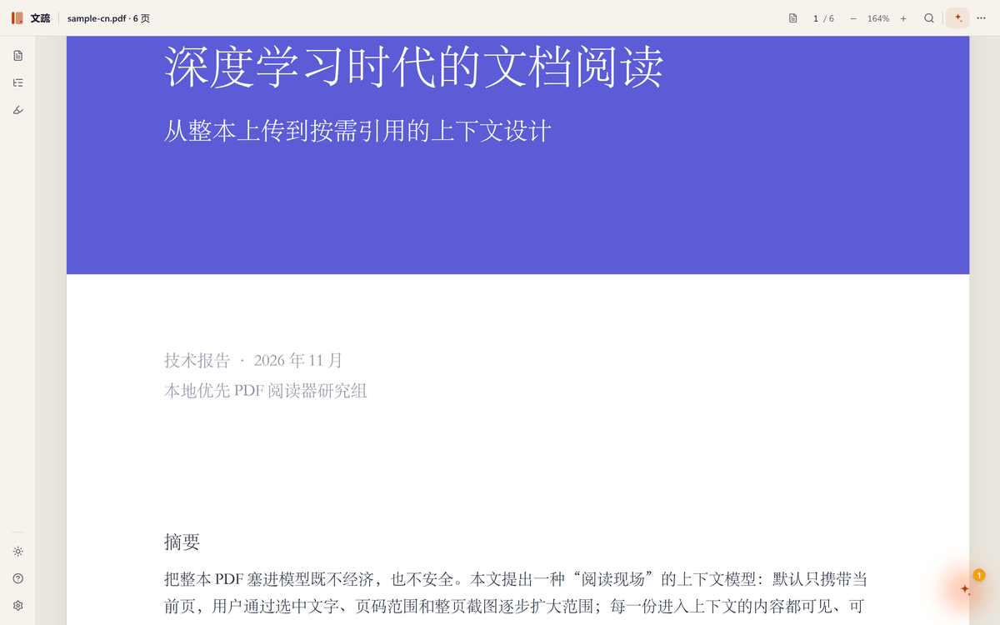
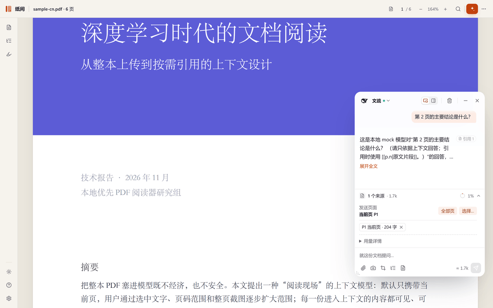
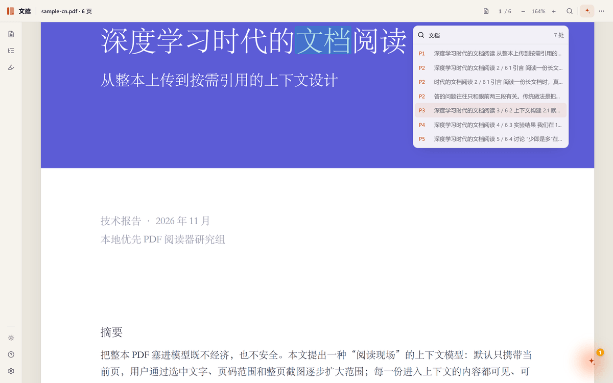
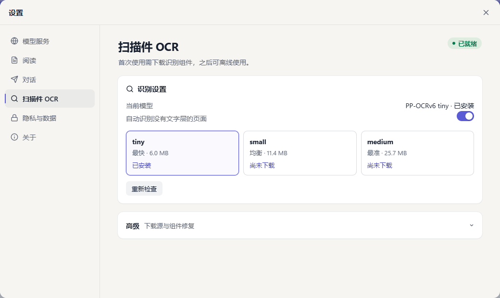
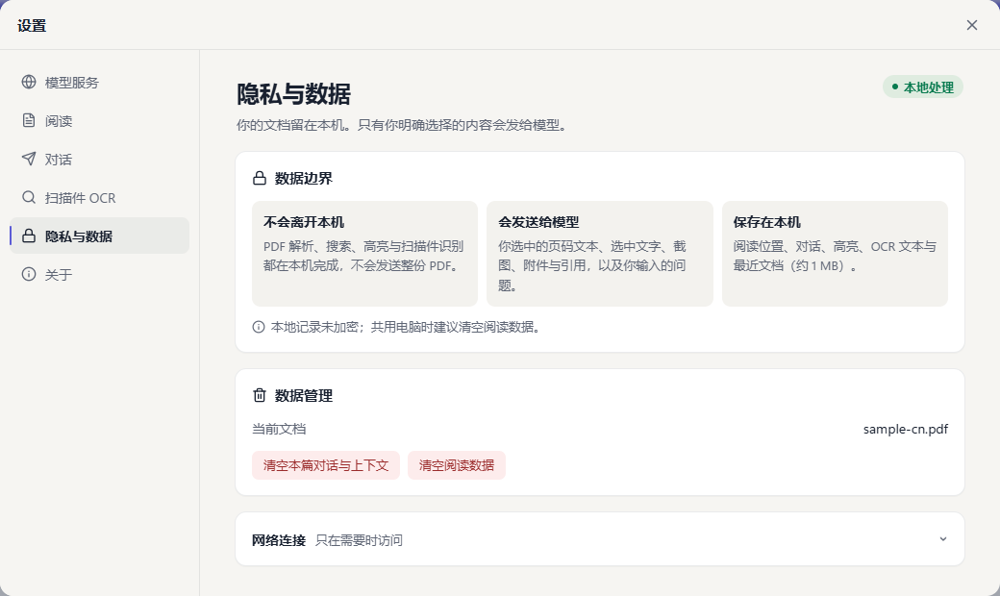
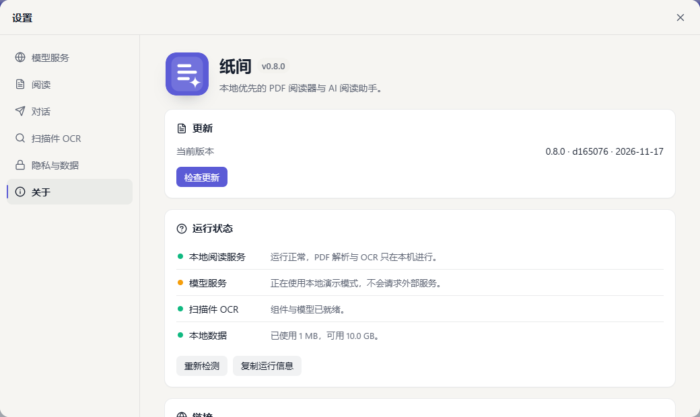

# 纸间 · PDF × AI 阅读器

本地优先的 PDF 阅读器与 AI 阅读助手。主 PDF 不上传；只有你明确选中的页、文字、截图和附件会发给模型。

[](https://github.com/salt-fishes/pdf-ai-reader/actions/workflows/ci.yml)
[](https://github.com/salt-fishes/pdf-ai-reader/releases)
[](LICENSE)



## 为什么是纸间

- **PDF 不上传**：pdf.js 在本地解析，模型只收到你勾选的上下文。
- **引用能跳回原文**：回答里的引用角标会带上原文短句，点击跳到对应行并短暂高亮。
- **扫描件也能用**：本机 OCR 生成行级文本层，可选中、搜索、高亮、提问。
- **长文档不硬塞**：本地 BM25 只发送相关段落；整本总结走 map-reduce。

## 一眼看懂

| 助手与引用                              | 上下文明细                              |
| --------------------------------------- | --------------------------------------- |
|  |  |

| 侧边栏形态                              | 搜索命中                             |
| --------------------------------------- | ------------------------------------ |
|  |  |

| 扫描件 OCR                       | 隐私与数据                            |
| -------------------------------- | ------------------------------------- |
|  |  |

关于页（运行状态、手动检查更新、默认 PDF 应用）：



## 功能

**阅读**

- 虚拟化页面列表、真实 DPR 渲染、100% = 96dpi、适合宽度 / 适合页面。
- Ctrl + 滚轮以指针为中心缩放，放大 / 缩小不改变当前阅读位置。
- 快捷键可在面板中逐项重新录制，支持冲突提示与恢复默认。
- 色彩模式：原色 / 反转 / 智能暗色 / 灰度 / 护眼 + 强度。
- 密码 PDF、最近文档、页面缩略图、目录、正文内外链接。
- 跨页选择、文字层对齐、缩放不漂移。

**检索与标注**

- 全文搜索在文字层上标出所有命中；跨行匹配拆成多个矩形。
- 高亮按文档持久化，可导出 Markdown / JSON。
- OCR 页的搜索与高亮带 `OCR` 标记。

**AI 上下文**

- 当前页 / 全部页 / 页码范围 / 目录章节 / 选中文字 / 整页截图 / 框选截图 / 附件 / 对话引用。
- 长文档本地 BM25 智能筛选；整本总结按约 3 万字分段后合并，可取消、有进度。
- 上下文预算、TokenMeter、provider usage 与费用单价。

**回答**

- SSE 流式输出、思考过程折叠、逐行引用与回跳高亮、Markdown + KaTeX。
- 多会话、自动命名、历史窗口；消息可引用或从上下文移除。

**OCR**

- PP-OCRv6 tiny / small / medium，本机 worker 推理，图片不上传。
- 桌面版不内置 OCR：首次在设置中开启时下载约 26MB 的运行时组件（解压约 71MB），
  再按需下载 tiny / small / medium 模型；下载会自动使用 Windows 系统代理，也可配置模型镜像根地址。
- 切换未下载模型先询问，下载成功后才切换。
- 应用升级会继续复用已安装的组件，不会因为版本号变化重新下载；组件损坏时可主动“修复组件”。

**桌面与隐私**

- Electron 壳自动启动本机代理，provider 配置、OCR 组件与模型、阅读数据写入本机应用数据目录。
- 无边框标题栏使用 Windows 原生窗口按钮，亮色/夜间主题同步；安装器、exe 与快捷方式统一图标。
- 双击关联的 PDF 直接打开；应用已运行时再次双击会复用窗口。
- 可在 设置 → 关于 中注册为 PDF 打开方式；不会自动修改默认应用，是否设为默认由 Windows 设置确认。
- 启动页先显示品牌壳，本地代理并行启动；本机实测窗口约 0.5s 出现、应用约 1.4s 就绪。
- 手动检查更新，只打开发布页；不后台轮询、不自动下载。
- 无遥测、无统计上报；代理默认只监听 `127.0.0.1`。

## 快速开始

需要 Node.js 24+。

### 浏览器

```bash
npm install
copy server\.env.example server\.env   # 填入 AI_API_KEY
npm run dev:all
```

打开 <http://127.0.0.1:5173>。

### 桌面版

```bash
npm run desktop:dev       # 开发壳
npm run package:desktop   # 可移植目录，输出到 release/
npm run build:installers  # NSIS .exe + MSI，输出到 release/
```

发布页同时提供便携 zip、NSIS 与 MSI；安装版和便携版都不内置 OCR，首次开启时下载组件。
NSIS 安装向导可选择“在 PDF 打开方式中显示纸间”（默认勾选），只声明打开方式，不会自动设为默认。

### 没有 API Key

在 `server/.env` 设置 `MOCK_AI=1`，用内置 mock 流验证界面、SSE 与引用回跳，不产生费用。

<details>
<summary>高级配置</summary>

| 变量                 | 说明                                                |
| -------------------- | --------------------------------------------------- |
| `AI_BASE_URL`        | OpenAI 兼容端点，默认 `https://api.deepseek.com`    |
| `AI_API_KEY`         | 仅服务端使用                                        |
| `AI_MODEL`           | 默认模型                                            |
| `AI_MODEL_ALLOW`     | 允许切换的模型，逗号分隔                            |
| `MOCK_AI`            | `1` 时使用本地 mock 流                              |
| `PORT` / `HOST`      | 默认 `8787` / `127.0.0.1`                           |
| `OCR_MODEL_DIR`      | 可写 OCR 模型根目录                                 |
| `OCR_RUNTIME_DIR`    | 可写 OCR 运行时目录（桌面版自动设置）               |
| `OCR_PACK_VERSION`   | 组件包版本；默认跟随桌面版                          |
| `OCR_PACK_URL`       | 覆盖组件包地址（镜像/离线测试）                     |
| `OCR_PACK_SHA_URL`   | 覆盖组件校验和地址                                  |
| `OCR_MODEL_BASE_URL` | tiny 模型默认下载镜像                               |
| `OCR_MODEL`          | 默认 OCR 模型：`v6-tiny` / `v6-small` / `v6-medium` |

也可以在 设置 → 模型服务 中配置 Base URL、允许列表、API Key 与费用单价。

</details>

## 隐私模型

| 本地                     | 发送给模型           |
| ------------------------ | -------------------- |
| 主 PDF 解析与渲染        | 选中页码的文本       |
| 搜索、高亮、缩略图       | 选中文字 / 引用      |
| OCR 推理与模型文件       | 整页 / 框选截图      |
| 对话、阅读位置、最近文档 | 你上传的附件与问题   |
| API Key（本机代理文件）  | 对话历史窗口内的消息 |

不发送整份 PDF、未选择的页面、文件名或本地路径。详见 [隐私说明](docs/PRIVACY.md)。

## 架构

- pdf.js 6.5.438 + 自绘虚拟化阅读器；页面尺寸缓存到 IndexedDB。
- 本机 Hono 代理持有密钥，前端只看到是否存在与尾号。
- 助手在浏览器内完成切块、BM25、Token 估算与截图裁剪。
- Electron 主进程负责启动代理、外链与手动检查更新。

更多见 [Architecture](docs/ARCHITECTURE.md)。

## 开发与测试

```bash
npm run typecheck
npm run lint
npm run format:check
npm test              # 81 个单元测试
npm run test:coverage # 覆盖率与 src/lib 阈值
npm run test:e2e      # 41 个 Playwright 用例（Edge；Linux 用 PW_CHANNEL=chromium）
npm run build
npm run build:server
```

发布前还会跑 `npm run check:docs`、`npm run check:motion` 与桌面打包，见 [Release](docs/RELEASE.md)。

## 文档

- [文档索引](docs/README.md)
- [架构](docs/ARCHITECTURE.md) · [桌面版](docs/DESKTOP.md) · [发版](docs/RELEASE.md)
- [隐私](docs/PRIVACY.md) · [品牌](docs/BRAND.md) · [OCR 镜像](docs/OCR-MIRROR.md)
- [路线图](docs/ROADMAP.md) · [规范化计划](docs/STANDARDIZATION-PLAN.md)

## 贡献与安全

请先读 [CONTRIBUTING.md](CONTRIBUTING.md)。安全问题按 [SECURITY.md](SECURITY.md) 私下报告。
第三方依赖与许可证见 [THIRD_PARTY_NOTICES.md](THIRD_PARTY_NOTICES.md)。

## License

MIT。见 [LICENSE](LICENSE)。
