# 纸间 · PDF × AI 阅读器

[](https://github.com/salt-fishes/pdf-ai-reader/actions/workflows/ci.yml)

本地优先的 PDF 阅读器，右下角一枚呼吸灯，点开后变成毛玻璃对话面板。AI 界面支持**悬浮窗**与**侧边栏**两种形态；阅读、选中、整页/框选截图、页码范围与引用回跳共用同一套上下文状态。主 PDF 不上传，只有你明确选中的内容才会发给模型。

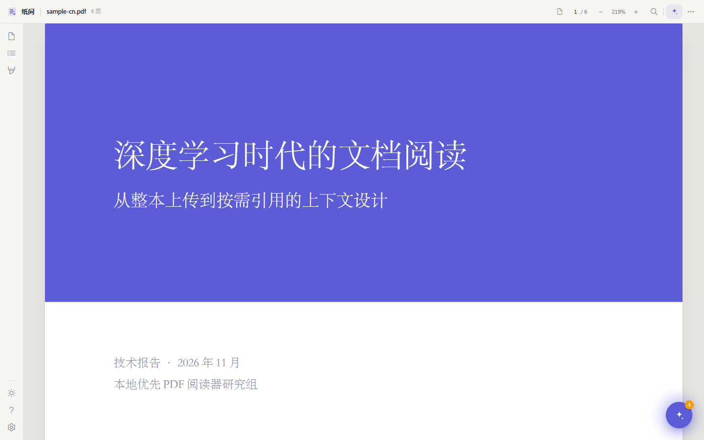

## 状态

P0 与主要 P1 已实现，浏览器和 Electron 桌面版都可运行：

- pdf.js 6.5.438 自绘虚拟化阅读器：连续滚动、文字层、中文 CMap、缩放、页码跳转、全文搜索 + 命中高亮、目录、高亮、懒加载页面缩略图。
- 顶部 `−` / `百分比` / `+` 缩放按钮，百分比菜单提供“适合宽度 / 适合页面 / 实际大小 100%”；`100%` 按 96dpi 映射（与 pdf.js viewer 一致），快捷键 `+/-/0` 同步可用。
- 设置可调**思考强度**（关闭 / 低 / 高 / 最高，映射 DeepSeek `reasoning_effort`）、**上下文预算**（32k–1M，默认 1M，只影响提示与 token 圆环，不阻止发送）与**对话历史窗口**（10/20/40/80/不限）。
- 文字渲染按精确页面尺寸和真实 `devicePixelRatio` 绘制，不再硬封顶 2.5×；画布总像素以 2²⁵ 为预算，超大页面才逐级降采样。浏览器缩放或跨屏移动后 DPR 变化会自动重渲染，不会让合成器把旧画布放大发虚；文字层用 `--total-scale-factor` 跟随缩放，选中框与字形对齐。
- **色彩模式**：原色 / 反转 / 智能暗色 / 灰度 / 护眼，强度 10–100% 可调。智能暗色用低分辨率亮度蒙版识别纸面，深色封面、照片和反白标题保持原样；反转 / 智能暗色时顶栏、侧栏、面板和设置同步切到深色。
- 呼吸灯（单层柔光）→ 面板的 FLIP 变形；最小化反向收缩；关闭时面板与呼吸灯一起隐藏，顶栏 AI 入口常驻。
- **两种助手形态**：悬浮窗覆盖阅读区，可拖动、上下左右四边与四角缩放；侧边栏停靠右侧，阅读区自动让位，拖动左缘可调宽度。切换按钮在面板标题栏，形态会持久化；窄屏统一为底部面板。
- 框选截图：从输入框点击裁剪图标（或 `Ctrl+Alt+R`），面板让位后在页面上拖拽选区，只把选中的区域发给模型；Esc 取消。
- 截图、图片附件与文本附件预览通过 portal 挂到 `body`，不会被浮窗圆角或 `overflow:hidden` 裁切；窄窗口下按视口宽高自动缩放。
- 面板、上下文展开、消息入场、思考状态、模式切换都有统一时长的过渡，并完整支持 `prefers-reduced-motion`。
- 上下文：当前页、页码范围、选中文字（支持跨页）、整页截图、附件（PDF/图片/文本）、对话引用；默认折叠为一行，展开看来源与 token 分桶。
- PDF 正文里的外部链接和内部跳转可点击；链接层不修改 PDF 内容。
- **页面选择器**：展开上下文后显示“当前页 / 全部页 / 选择…”；选择器内可直接输入 `3`、`3-7`、`2,5,9-12`，也可点击 PDF 目录章节加入该章页码范围。页码范围与当前页互斥，发送时不再叠加。
- **整本总结**：输入框工具栏和空状态都可触发。小文档直接一次总结；长文档按约 3 万字分段，逐段摘要后合并，显示进度、可取消；分段结果按文档/模型缓存，重复总结只重跑最后合并。
- **高亮持久化**：高亮按文档存入 IndexedDB，刷新/重新打开后恢复；左侧“高亮”栏可导出 Markdown 或 JSON。
- **虚拟页面列表**：只挂载可视区附近的页面；5000 页实测滚动 p95 约 15ms、DOM 约 126 个节点，跳页不依赖全量页面 DOM。
- **密码 PDF**：加密文档弹出密码框，错误密码可重试，取消后保留当前文档。
- **最近文档**：≤24MB 的 PDF 在本机缓存字节，空文档页与“更多”菜单可直接重开。
- **引用回跳**：记录每页最后阅读位置，引用点击回到该页的阅读锚点。
- **模型服务设置**：Base URL、默认模型、允许列表、API Key 可在设置里配置（密钥只写入本机代理）；费用单价（未命中输入 / 缓存命中 / 输出）也可配置，用于本地估算。
- 助手回答支持 Markdown + KaTeX：`$...$`、`$$...$$`、`\(...\)`、`\[...\]` 都会渲染；行间公式在窄面板内横向滚动，不会被裁切。
- 长文档智能筛选（P1）：本地按 800 字切块、中文 bigram + BM25 打分，只把与问题最相关的段落发给模型；显示“已从 32 页中筛选 4 段”，可展开看页码、匹配问题并逐页回跳。整本 PDF 不参与上传。启用后会替换当前页上下文，避免无关页混入。
- 回答 `[[p.n]]` 渲染为可点击引用，只对本次上下文中的页码生成按钮；点击滚动并闪烁原页。
- TokenMeter：provider usage 锚点 + 增量估算 + 未命中/缓存命中/缓存写入/输出分桶；CJK 按 0.6 token/字估算。
- 消息右键“引用 / 从上下文移除”，中键快捷切换；清空需二次确认。
- 多会话：同一 PDF 可建多个对话，按首句自动命名，可切换、删除；每个会话独立保存消息、模型与 token 锚点，清空只影响当前对话。
- 扫描件 OCR（可选）：PP-OCRv6 tiny（约 6.0 MB）首次使用才下载；扫描页提示条一键识别，文本进入当前页上下文、搜索和 BM25，模型与图片只留在本机代理。
- 快捷键：`Ctrl+J`、`Alt+J`、`Ctrl+K`、`?`、`Ctrl+F`、`PageUp/Down`、`+/-/0`、`Shift+D`、`Ctrl+Alt+S`、`Ctrl+Alt+R`、`Ctrl+Alt+Q`。
- 本地 Node 代理（Hono）转发 SSE；密钥可放 `server/.env`，也可在设置中写入 `server/data/provider.json`；默认只监听 `127.0.0.1`。
- **Electron 桌面版**：自动启动本地代理、单实例、外链交给系统浏览器；`npm run desktop:dev` 开发，`npm run package:desktop` 生成可移植目录，`npm run build:desktop` 生成 NSIS/portable 安装包。详见 [docs/DESKTOP.md](docs/DESKTOP.md)。
- 已接真实 `deepseek-flash`：思考流（`reasoning_content`）折叠显示并标注“生成中 / N 字”，回答、引用、usage 与费用分桶均来自真实响应；`deepseek-v4-pro` 可在面板内切换。

## 快速开始

要求 Node 24+（本项目已在 Node 24.15 验证）。

```bash
cd pdf-ai-reader
npm install

# 复制配置并填入真实密钥
copy server\.env.example server\.env
# 编辑 server/.env：AI_API_KEY=sk-...

npm run dev:all
```

打开 <http://127.0.0.1:5173>。Vite 会把 `/api` 代理到 `127.0.0.1:8787`。

### 没有密钥时先看界面

`server/.env` 里设置：

```bash
MOCK_AI=1
```

重启代理后，发出的问题会得到内置的流式 mock 回答（带引用与 usage），用于验证界面、停止、引用回跳和 token 分桶，不调用真实模型、不产生费用。默认关闭。

### 生产构建

```bash
npm run build
npm start
```

`npm start` 由 Hono 同时提供 `dist/` 静态文件与 `/api`，默认 <http://127.0.0.1:8787>。

### 桌面版

```bash
npm run desktop:dev     # Vite/API + Electron 开发壳
npm run desktop         # 本地生产模式（构建后启动 Electron）
npm run package:desktop # 可移植桌面目录（release/win-unpacked）
npm run build:desktop   # NSIS 安装包 + portable exe（需要 electron-builder 二进制）
```

桌面版把 provider 配置、OCR 模型与 IndexedDB 放在 Electron `userData`，不写入安装目录。详见 [docs/DESKTOP.md](docs/DESKTOP.md)。

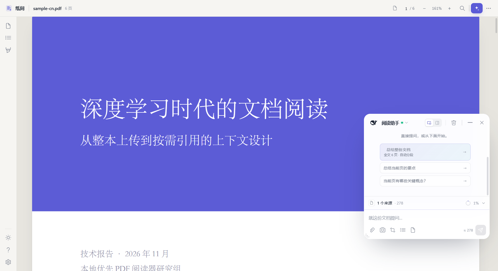

### 验证真实模型

代理启动后，这些脚本会直接使用 `server/.env` 里的真实密钥：

```bash
npm run smoke         # 代理级：文本引用、截图理解、usage、非法模型拦截
npm run smoke:ui      # Edge 全流程：打开 PDF → 限定页码 → 提问 → 思考流 → 引用回跳
npm run smoke:vision  # Edge 全流程：只发整页截图 → 校验模型读图结果
npm run smoke:smart   # Edge 全流程：32 页文档 → BM25 筛选 → 只引用相关页
npm run smoke:region  # Edge 全流程：标题区域框选 → 只发选区 → 校验读图
```

这些脚本会把真实模型的思考态、回答态、截图理解、筛选结果写入 `docs/real-*.png`。想先不花钱看界面，仍可设置 `MOCK_AI=1`。

### 两种助手形态

面板标题栏的切换键在“悬浮窗 / 侧边栏”之间切换，选择会持久化：

- **悬浮窗**：覆盖在阅读区上，不改变页面排版；拖动标题栏移动，拖四边/四角缩放。
- **侧边栏**：从顶栏下方停靠右侧，阅读区自动让位；拖左缘调整宽度，窄屏自动变为底部面板。

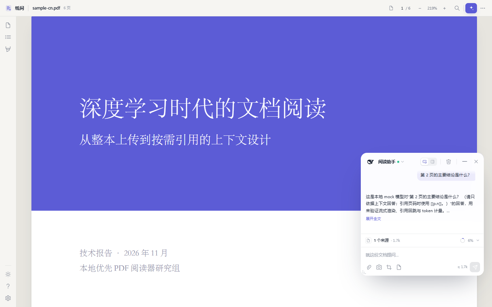

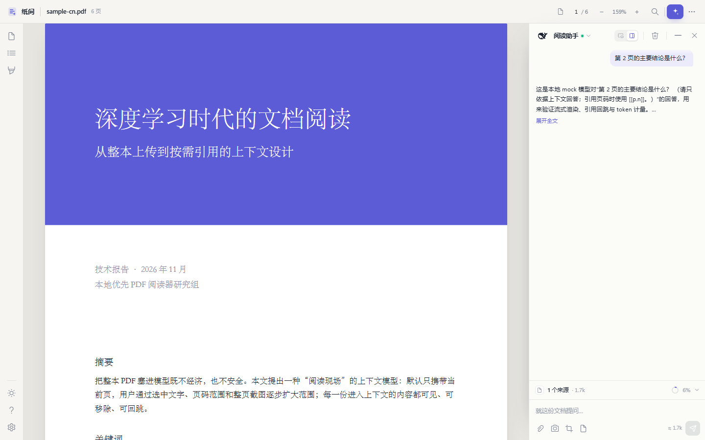

### 页面选择、整本总结与高亮

- 输入框的“限定页码”打开页面选择器：**当前页 / 全部页 / 自定义**；自定义输入始终可见，支持 `3`、`3-7`、`2,5,9-12`。
- 如果 PDF 带目录，选择器会列出章节与页码范围，点一下就把该章加入上下文；左侧目录栏的页码徽标也可以直接点击加入。
- 页码范围与“当前页”是互斥范围：选择页码后，翻页不会偷偷把当前页再塞进上下文。
- **整本总结**：输入框工具栏或空状态触发。小文档一次发送；长文档按约 3 万字分段，逐段摘要后合并，显示进度、可取消；分段结果按文档/模型缓存，第二次只重跑合并。
- **高亮持久化**：选中文字点“高亮”，按文档写入 IndexedDB；刷新或重新打开后仍在。左侧“高亮”栏可导出 Markdown / JSON。
- 支持**跨页选择**：从第 1 页拖到第 2 页，工具栏会显示“选中 · P1–P2”，上下文按页标记发送。
- PDF 正文的外部链接与内部跳转可点击；链接层不修改 PDF。
- 公式支持 `$...$`、`$$...$$`、`\(...\)`、`\[...\]`；行间公式在窄面板内可横向滚动。


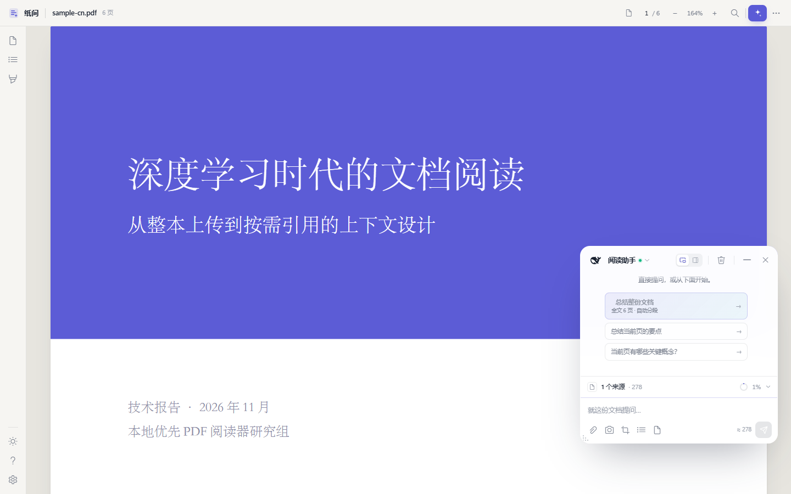

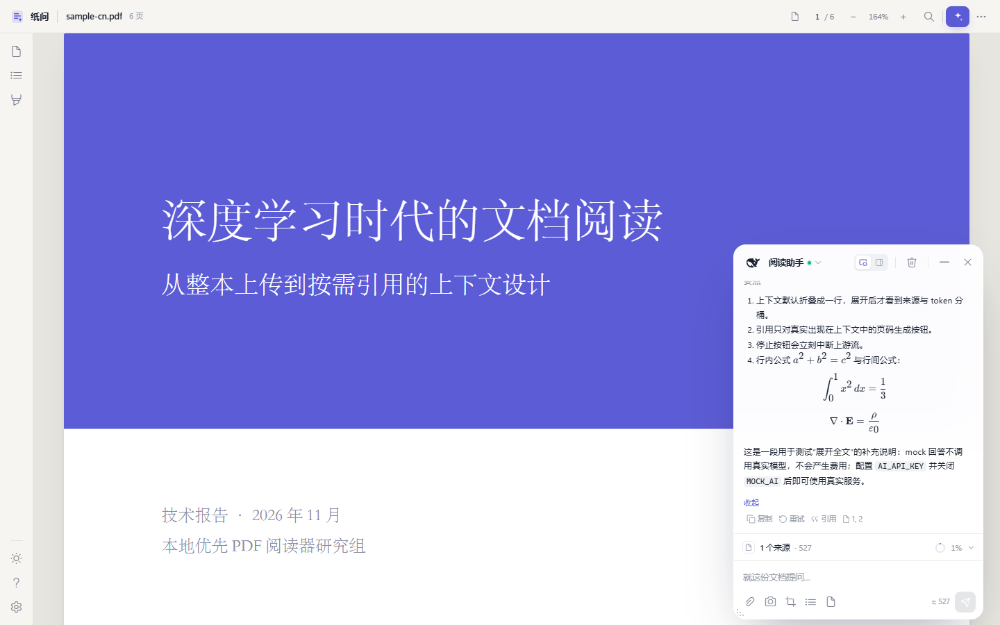

### 阅读与模型控制

- 顶栏百分比可直接缩放；点击百分比可选“适合宽度 / 适合页面 / 实际大小 100%”。
- 文字层按 `viewport.scale` 设置 `--total-scale-factor`，选中框、双击选词与画布字形保持同一基线；缩放或切换适合宽度/页面后不会漂移。
- 设置 → 对话：**思考强度**（关闭 / 低 / 高 / 最高）、**上下文预算**（32k–1M，默认 1M）与**历史窗口**（10/20/40/80/不限）。
- 思考强度映射 DeepSeek `reasoning_effort`：关闭时走非思考模式，更高强度会消耗更多 reasoning token。
- 上下文预算是软限制，只影响提示、token 圆环和阅读建议；真正的硬上限是模型 1M 上下文。超限时会建议改用整本总结或智能筛选。
- 设置 → 模型服务：Base URL、默认模型、允许列表、API Key、费用单价都可在 UI 配置；密钥只写入本机代理。

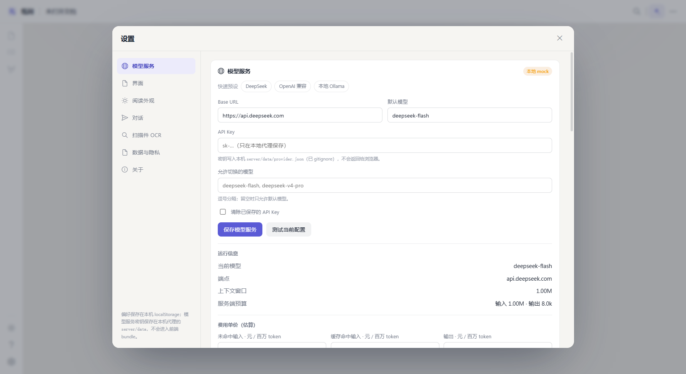

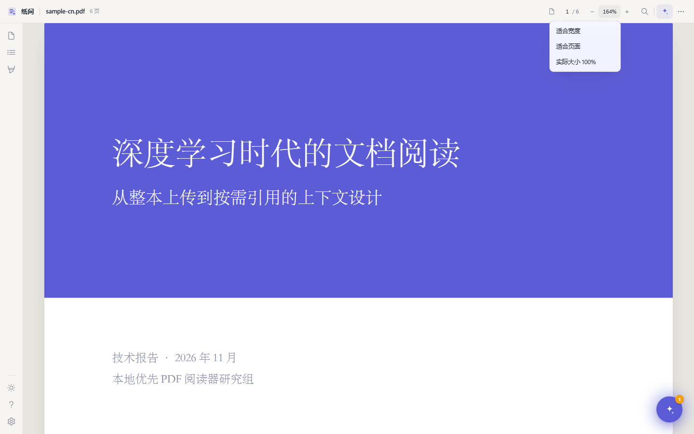

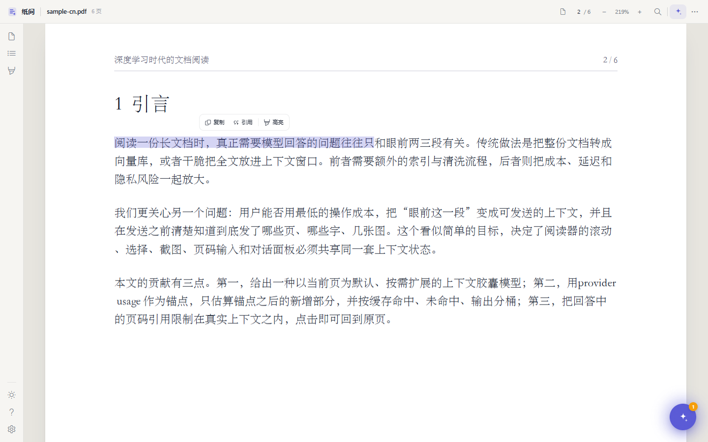

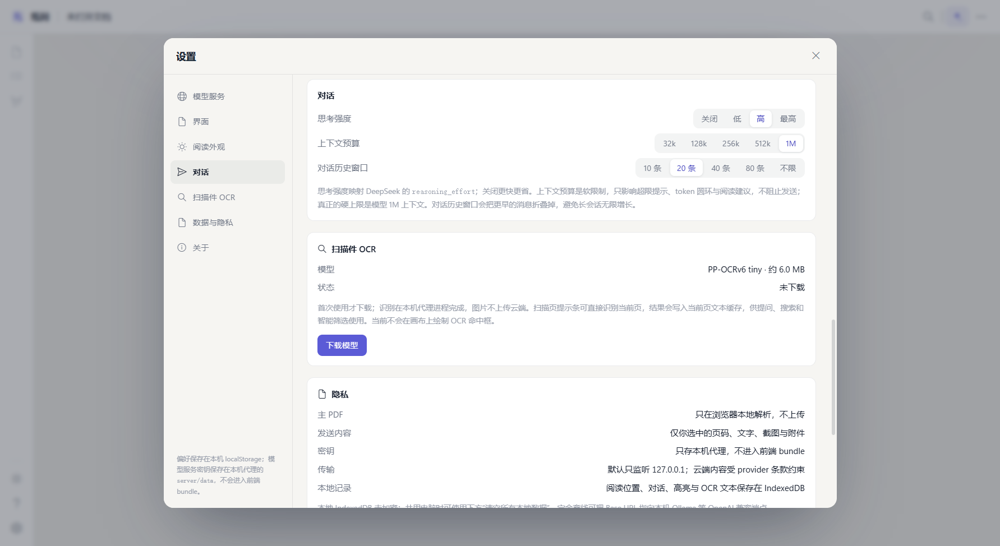

关闭思考后不再出现“思考过程”，直接作答：

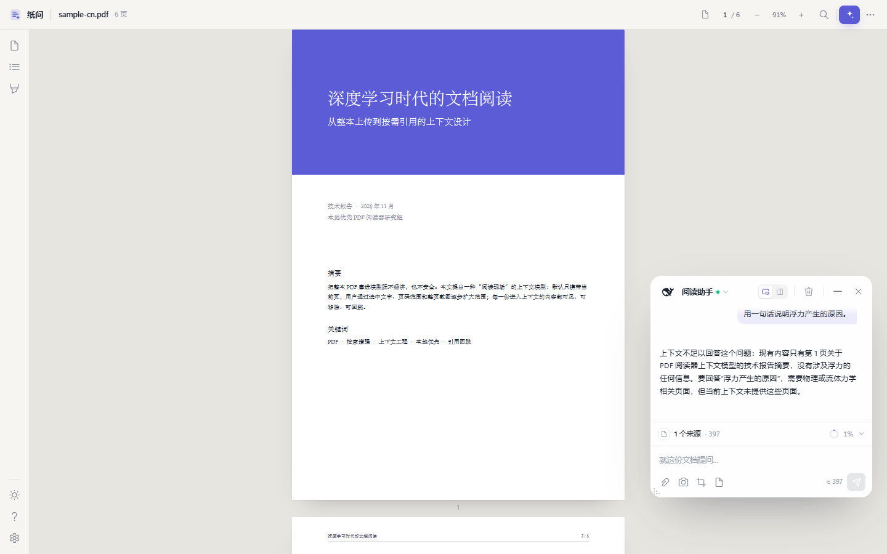

### 长文档智能筛选

打开 8 页以上的 PDF，在输入框写好问题，点“限定页码 → 智能筛选全文”。本地会扫描页面（默认前 400 页）、按约 800 字切块，用中文 bigram + BM25 打分，只发送最相关的至多 8 段（约 12k 字以内），并按最高分过滤共享样板文字。上下文行会显示“已从 N 页中筛选 M 段”，展开可看匹配问题、命中页码与 token 分桶；整本 PDF 仍不上传。

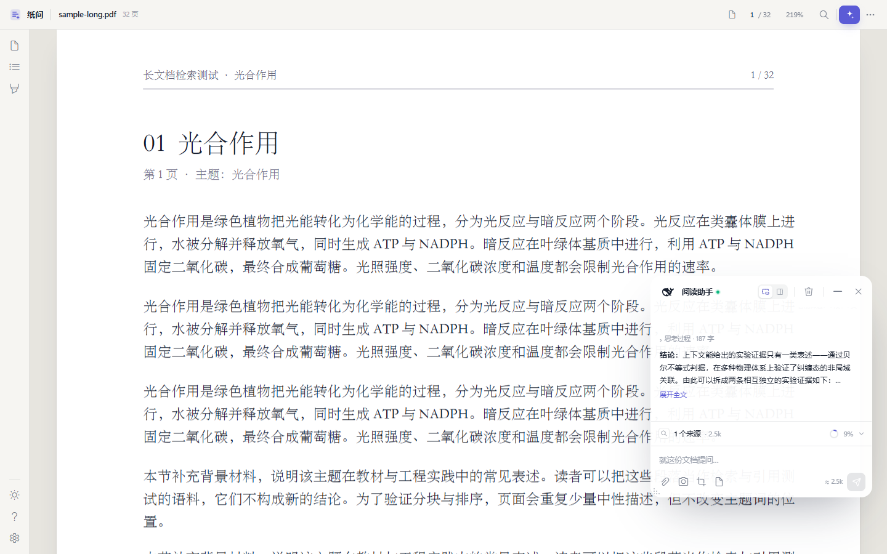

### 框选截图

点输入框的裁剪图标，或按 `Ctrl+Alt+R`，面板会收起；在页面上拖拽选区，松手后只把这一块截图加入上下文（Esc 取消）。截图与整页截图共用“每轮最多 4 张图”的限制。

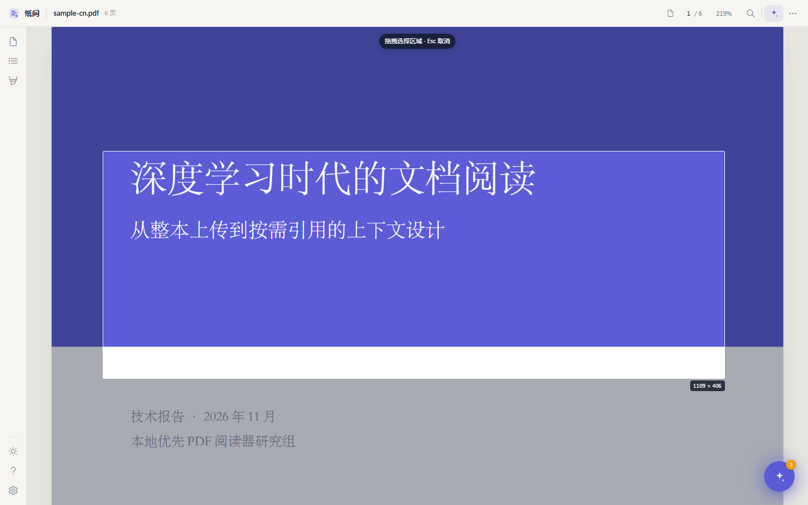

### 缩略图与色彩模式

- 左侧“页面”栏以双列缩略图展示，使用 `IntersectionObserver` 懒加载并缓存；点击即跳页。
- 左下角图标打开色彩模式面板：**原色 / 反转 / 智能暗色 / 灰度 / 护眼**，下方滑杆调整强度（10–100%）。选择会持久化；`Shift+D` 可循环切换。
- **智能暗色** 先用 48px 宽的亮度蒙版判断纸面与深色区域，再只反相纸面：白纸变深灰、文字提亮，深色封面、彩色照片和反白标题保留原样。蒙版经过中值滤波，避免文字周围出现反相光晕。
- 反转 / 智能暗色会同时把顶栏、侧栏、助手面板和设置切成深色；灰度、护眼和原色保持浅色界面。
- 所有滤镜直接在画布像素上完成（离屏原图 + 合成），调整强度不会重新渲染 PDF，也不会因 CSS 滤镜导致文字模糊。设置 → 阅读外观提供同一组控件。

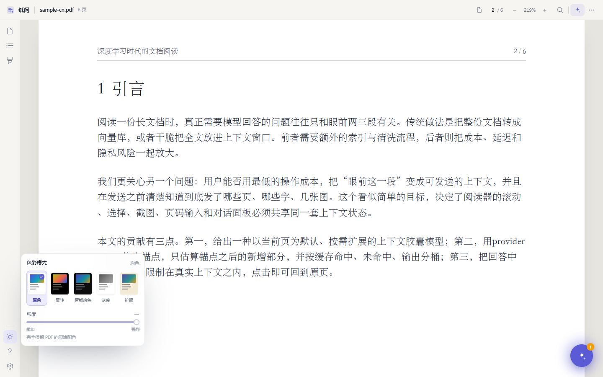

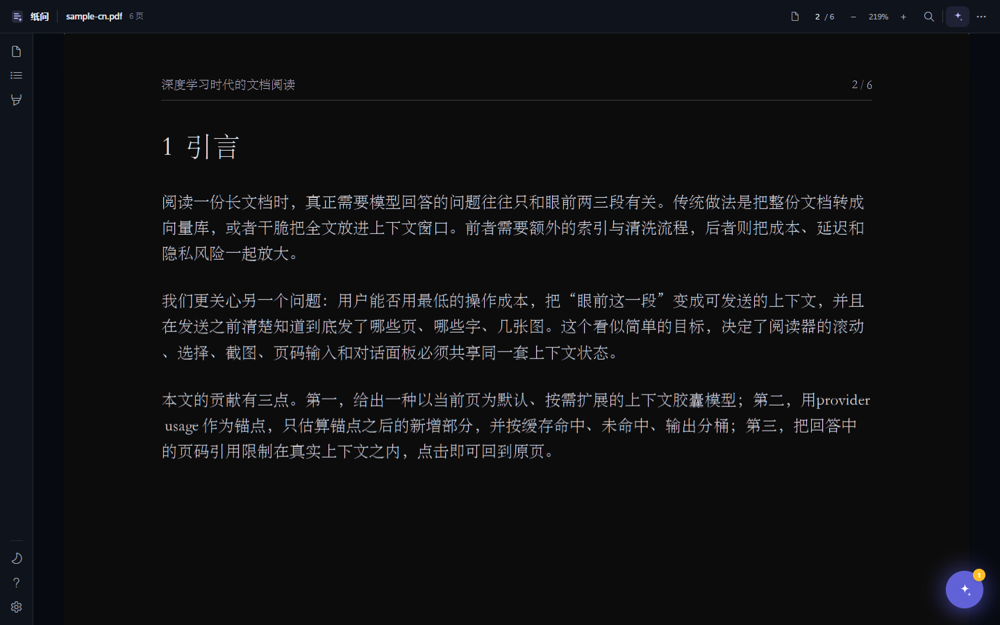

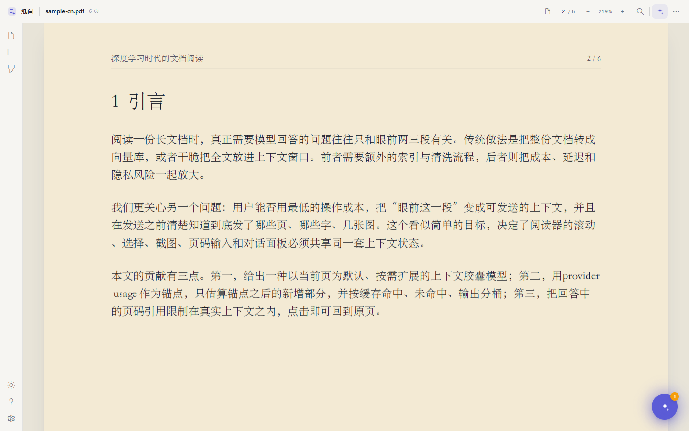

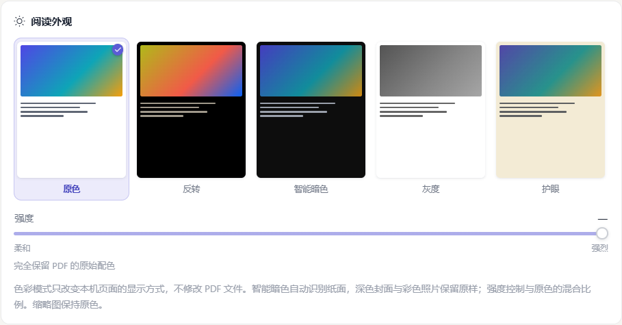

### 搜索高亮

`Ctrl+F` 输入关键词后，结果列表按页列出；点击任一条会跳到该页，并在文字层上以青色标出所有命中（跨行匹配会拆成多个矩形）。关闭搜索即清除高亮。

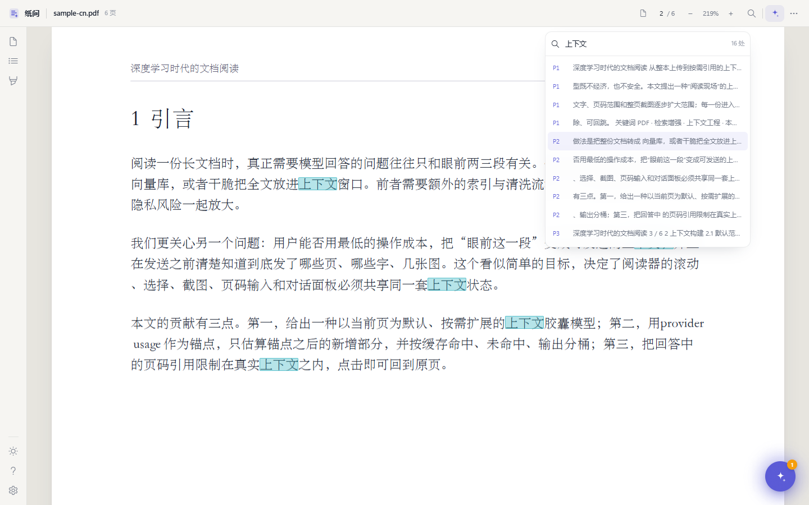

### 多会话

点击面板标题旁的箭头打开对话列表：可新建、切换、删除会话。标题取首句前 18 字；每个会话独立保存消息、模型与 token 锚点，切换后自动恢复；清除只影响当前对话。


### 扫描件 OCR（后台自动）

页面没有文字层时，阅读器会在 650ms 空闲后自动把当前页加入 OCR 队列；模型缺失时在后台准备，不弹窗、不打断阅读。识别在本机代理的 worker 线程中运行（onnxruntime-node），图片不会上传云端，也不会阻塞滚动或聊天流。

- 识别结果写入当前页文本缓存，可直接提问，也会被全文搜索、BM25 智能筛选和整本总结使用。
- 生成**行级 OCR 文本层**：扫描页可以像普通 PDF 一样拖选、双击、复制、高亮、引用和搜索；页面、侧栏、搜索结果和上下文都会标注 `OCR`，首次选中会提示“可能有误差”。
- OCR 结果按页缓存到 IndexedDB，重新打开 PDF 不需要再次识别；高亮跳转会直接落到高亮行。
- 模型分三档：`tiny`（默认，约 6.3 MB）、`small`、`medium`。tiny 随桌面版分发（存在时），small / medium 在设置 → 扫描件 OCR 中按需下载；切换模型会自动重启 OCR worker。
- 设置里可以关闭 OCR 文本层；关闭后扫描页回到纯图片阅读，但仍可手动在设置中重新开启。
- 模型目录：`server/models/ppocrv6`（tiny，`det.onnx`、`rec.onnx`、`dict.txt`）以及 `ppocrv6-small` / `ppocrv6-medium`；桌面版把可写模型放在 Electron `userData/ocr-models`。可用 `OCR_MODEL_DIR` 指定可写根目录。
- 也可从 [oar-ocr v0.7.0](https://github.com/GreatV/oar-ocr/releases/tag/v0.7.0) 手动下载 tiny 的三个文件并按上面的文件名放入目录。模型来自 PaddleOCR PP-OCRv6（Apache-2.0），ONNX 转换由 oar-ocr 发布；运行时使用 `ppu-paddle-ocr`（MIT）与 `onnxruntime-node`。
- `onnxruntime-node` 作为 npm 依赖随安装；只有模型文件按需下载。

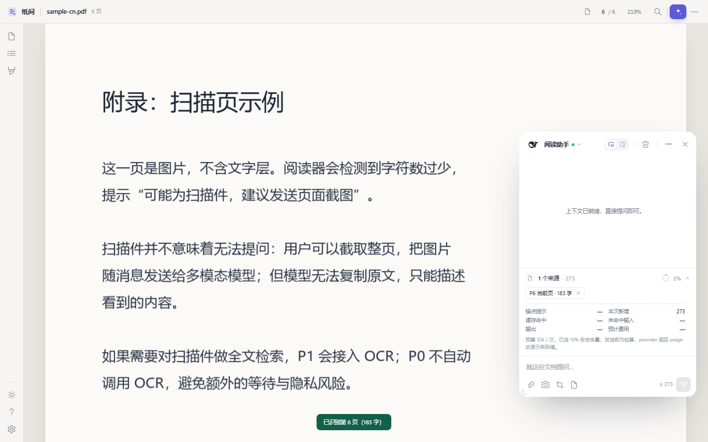

### 测试

```bash
npm test          # Vitest：页码、章节范围、历史窗口、token、prompt、引用、SSE、BM25、渲染分辨率
npm run test:e2e  # Playwright（默认用系统 Edge）：PDF、引用跳转、智能筛选、框选、双形态、缩略图、色彩模式、文字层对齐、搜索高亮、多会话、OCR、页面选择器、整本总结（含长文分段）、KaTeX、截图预览、跨页选择、正文链接、高亮持久化/导出、缩放/思考强度/预算、拖动/四边缩放、DPR 变化重渲染、响应式
```

E2E 默认复用已启动的开发服务器；若未启动，Playwright 会自行启动并把代理切到 mock 模式。没有 Edge 时，设置 `PW_CHANNEL=chromium` 并先执行 `npx playwright install chromium`。
E2E 启动前会检查代理必须是 `MOCK_AI=1`，避免误用真实密钥产生费用。

## 配置

`server/.env`：

| 变量                 | 说明                                                                                            |
| -------------------- | ----------------------------------------------------------------------------------------------- |
| `AI_BASE_URL`        | OpenAI 兼容端点，默认 `https://api.deepseek.com`                                                |
| `AI_API_KEY`         | 服务端密钥；不要写进前端                                                                        |
| `AI_MODEL`           | 默认模型，默认 `deepseek-flash`                                                                 |
| `AI_MODEL_ALLOW`     | 允许前端切换的模型，逗号分隔；留空时只能使用 `AI_MODEL`                                         |
| `MOCK_AI`            | `1` 时使用内置 mock 流，不访问真实模型                                                          |
| `PORT` / `HOST`      | 默认 `8787` / `127.0.0.1`                                                                       |
| `APP_ORIGIN`         | 开发前端地址，写入 `/api/config`                                                                |
| `OCR_MODEL_BASE_URL` | 可选：tiny 模型下载镜像前缀，默认 GitHub release；国内网络可换镜像                              |
| `OCR_MODEL_DIR`      | 可选：可写模型根目录（包含 `ppocrv6`、`ppocrv6-small`、`ppocrv6-medium`）；默认 `server/models` |
| `OCR_MODEL`          | 可选：默认 OCR 模型，`v6-tiny` / `v6-small` / `v6-medium`，默认 `v6-tiny`                       |

换 provider 时选一个多模态模型（Qwen-VL / GLM-4V / Gemini / GPT-4o 等），截图与文字走同一个模型。

## 目录

```text
src/
  app/                    顶栏、左侧栏、搜索、布局
  features/viewer/        pdf.js 渲染、虚拟化、文字层、选择、高亮、框选
  features/assistant/     呼吸灯、悬浮窗/侧边栏、消息、上下文、token 环、快捷键
  features/settings/      模型、形态与隐私设置
  lib/pdf/                加载、文本、截图、选区裁剪、页码解析
  lib/ai/                 prompt、SSE、引用、BM25、provider 客户端
  lib/ocr/                OCR 客户端（状态 / 下载 / 识别）
  lib/tokens/             估算与 TokenMeter
  lib/storage/            IndexedDB / localStorage
  components/icons/       Segoe Fluent、lobe-icons、手写 SVG
server/src/index.ts       Hono 代理 + 静态文件 + mock 流
server/src/ocr.ts         PP-OCRv6 可选安装与本机推理
server/models/            OCR 模型（可选下载，已 gitignore）
scripts/                 真实模型冒烟（代理级 / UI / 截图 / 智能筛选 / 框选）
public/pdfjs/             cmaps / standard_fonts / wasm / iccs
tests/unit/               Vitest
tests/e2e/                Playwright
tests/fixtures/           中文样例 PDF（STSong-Light）与生成脚本
```

## 隐私

- 主 PDF 在浏览器本地解析，字节不离开浏览器。
- 只有页码文本、选中文字、截图、附件和你输入的问题会经本地代理发给模型。
- 默认模型是云端 `deepseek-flash`：被选中的内容会发送到 `api.deepseek.com`，受其服务条款与数据政策约束。要完全离线，把 `AI_BASE_URL` 指向本地 Ollama 等 OpenAI 兼容端点。
- 密钥只存在 `server/.env`（已在 `.gitignore` 中），不会进入前端 bundle、浏览器存储或对话记录。
- 截图默认长边约 1568px、JPEG 0.86；单轮最多 4 张。
- OCR 图片只发送到本机代理，模型和识别文本保存在本机；OCR 文本进入上下文后，才会随普通页文本一起发给云端模型。
- 对话与阅读位置保存在本机 IndexedDB；清空对话不会修改 PDF。
- 服务端不记录 prompt、文档文本或图片。

## 已知限制 / 下一步

- DOCX 导入、双页/横向阅读尚未实现。
- OCR 文本层是行级框，不是词级框；倾斜或双栏页面的选区可能略宽，词级命中框留作后续增强。
- 引用回跳使用“该页最后阅读位置”作为启发式锚点，不是对模型引用语句的字级定位。
- 最近文档只缓存 ≤24MB 的文件；更大的 PDF 需要重新选择。
- 桌面 zip 实测约 183MB；Electron 本体、ONNX Runtime、canvas/opencv 是主要体积来源。
- 上下文预算是本地软限制，默认 1M；真正的硬上限是模型上下文窗口。实际费用以 provider usage 为准。
- 智能暗色使用 48px 的粗粒度亮度蒙版，超大深色/浅色块交界处会有约 20px 的柔和过渡；缩略图保持原色，不套用页面滤镜。
- 色彩滤镜使用 Canvas 2D 的 `filter`，依赖 Chromium / Edge / WebView2；其他内核需要额外的像素级回退。
- 前端按需拆分：首屏约 125KB gzip；打开 PDF 后加载 pdf.js 约 134KB；打开面板后加载 Markdown/KaTeX 约 152KB。
- 服务端默认单用户、本机使用；局域网部署需自行加认证、限流与 TLS。
- 代理不强制 `max_tokens`，输出长度由模型与问题决定；费用以 provider 返回的 usage 为准。
- Electron 安装包未做代码签名与自动更新；部分受控文件夹/杀毒软件会阻止写入 DLL，可改用 `npm run package:desktop` 输出到普通目录或临时目录。
- OCR 模型下载目前只校验文件是否完整，生产环境建议增加 SHA-256 校验。

## 开源

- [MIT License](LICENSE)
- [贡献指南](CONTRIBUTING.md)
- [安全策略](SECURITY.md)
- [行为准则](CODE_OF_CONDUCT.md)
- [变更记录](CHANGELOG.md)
- [路线图](docs/ROADMAP.md)
- [桌面版](docs/DESKTOP.md)
- [English README](README.en.md)
